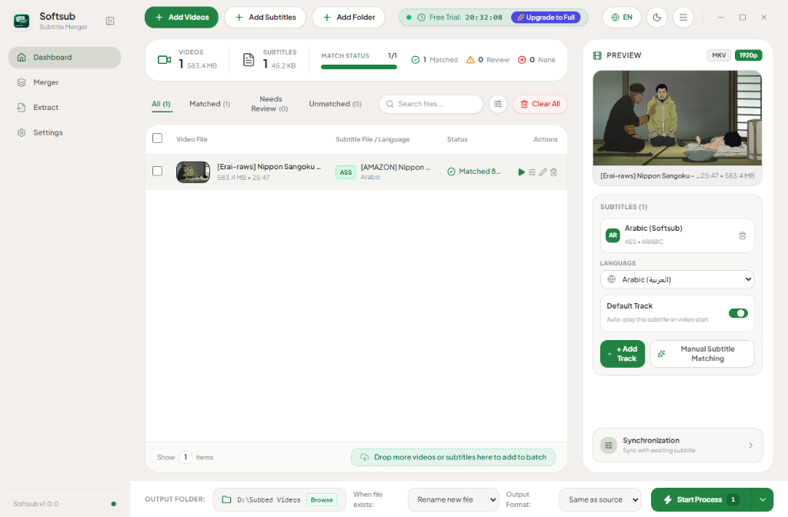
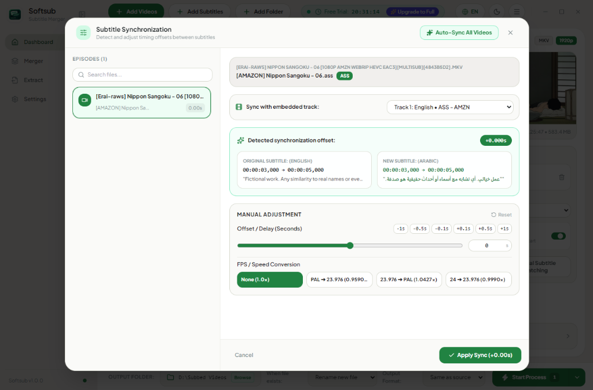

  
  <h1 align="center">Softsub</h1>
  

    <b>Modern Windows Desktop Application for Soft Subtitle Merging, Batch Matching, and Synchronization</b>
     
    <b>تطبيق مكتبي متطور لدمج ومزامنة واستخراج الترجمات داخل مقاطع الفيديو فورياً بدون إعادة ترميز</b>
  

  

    
    
    
  

  

    <a href="#english">English</a> • <a href="#العربية">العربية</a>
  

---

## 🌐 English

### 📥 Download & Installation
You can download the latest official release for Windows (10 / 11 64-bit) directly:

👉 **[Download Softsub v1.0.0 for Windows (Portable / Installer)](https://github.com/MhDTam/Softsub/releases/latest)**

*No complex installation required — simply download, run, and start merging subtitles!*

---

### Overview
**Softsub** is an ultra-fast, modern Windows desktop tool designed for anime fans, translators, media collectors, and video editors. It enables effortless muxing of soft subtitles (SRT, ASS, VTT, SSA) into video containers (MKV, MP4) in seconds using high-speed container remuxing — completely eliminating the need for slow re-encoding and preserving 100% of the original video and audio quality.

---

### 📸 Application Preview

#### 1. Main Dashboard & Batch Inspector
Organize episodes, automatically match external subtitles with videos, inspect audio/subtitle tracks, and preview video frames in real time:

  

#### 2. Subtitle Synchronization & Offset Calibration
Calibrate subtitle timing down to milliseconds, fix audio drift, and apply instant framerate conversions (PAL, NTSC, 23.976 fps):

  

---

### ✨ Key Features
- **⚡ Instant Soft-Muxing (Zero Re-encoding):** Merge subtitles into video containers in seconds without recompressing video or losing a single bit of quality.
- **🎯 Smart Batch Auto-Matching:** Automatically pairs multiple video files with corresponding subtitle files across entire folders using intelligent title and episode pattern recognition.
- **🎨 Dual Subtitle Merging:** Combine two different languages into a single styled ASS/SRT file with customizable typography, colors, font sizes, and screen placements (top/bottom).
- **🔊 Audio & Subtitle Extractor:** Extract internal subtitle streams or lossless audio tracks (or convert to MP3 / FLAC / AAC / WAV) with a single click.
- **🖥️ Modern Windows 11 Fluent UI:** Beautiful light and dark themes with native support for both English (LTR) and Arabic (RTL) interfaces.

---

### 💻 System Requirements
- **Operating System:** Windows 10 (64-bit) or Windows 11
- **Processor:** Any modern 64-bit Intel / AMD CPU
- **Memory (RAM):** 2 GB minimum (4 GB recommended)
- **Disk Space:** ~250 MB free disk space

---

### 📄 License
Copyright © 2026 Mohammed Abdulsalam / Softsub Team. All rights reserved.  
This software is proprietary and closed-source. Unauthorized redistribution or reverse engineering is prohibited.

---

## 🇸🇦 العربية

### 📥 التحميل والتشغيل
يمكنك تحميل أحدث إصدار رسمي لنظام ويندوز (10 / 11 64-بت) مباشرة:

👉 **[تحميل برنامج سوفت سب (Softsub v1.0.0) لويندوز](https://github.com/MhDTam/Softsub/releases/latest)**

*البرنامج محمول وسريع — حمّل الملف وشغّله فوراً للبدء بدمج الترجمات!*

---

### نظرة عامة
**سوفت سب (Softsub)** هو برنامج مكتبي عصري وفائق السرعة لنظام ويندوز، مخصص للمترجمين، وفرق الترجمة، ومحبي الأنمي والأفلام، وهواة جمع الوسائط. يتيح لك دمج الترجمات النصية بصيغها المختلفة (SRT, ASS, VTT, SSA) داخل حاويات الفيديو (MKV / MP4) خلال ثوانٍ معدودة وبدون إعادة تشفير الفيديو نهائياً، مع الاحتفاظ بجودة الصورة والصوت الأصلية بنسبة 100%.

---

### 📸 لقطات حية من داخل التطبيق

#### 1. لوحة التحكم وإدارة دفعات الفيديو
مطابقة تلقائية ذكية بين الحلقات والترجمات، مع فحص مسارات الصوت والترجمة المدمجة، ومعاينة حية للمشاهد:

  

#### 2. نافذة مزامنة وتوقيت الترجمات
ضبط وتعديل فارق التوقيت بدقة أجزاء الثانية، وحل مشكلة انزياح الصوت، وتحويل معدل الإطارات (23.976fps, PAL, NTSC) بضغطة زر:

  

---

### 🌟 أبرز ميزات البرنامج
- **⚡ دمج فوري فائق السرعة:** دمج الترجمات داخل الفيديو في ثوانٍ معدودة بدون إعادة ترميز أو ضغط للصورة.
- **🎯 مطابقة ذكية للدفعات:** ربط تلقائي ذكي بين مقاطع الفيديو وملفات الترجمة في المجلد حتى مع اختلاف صيغ التسمية.
- **🎨 دمج ترجمتين مزدوجتين (Dual Subtitles):** دمج لغتين معاً بتنسيقات ألوان وأحجام خطوط ومواقع شاشة مختلفة (أعلى/أسفل).
- **🔊 استخراج المسارات:** إمكانية استخراج الترجمات المدمجة أو استخراج الصوت الخام وتحويله إلى صيغ شهيرة (MP3 / FLAC / AAC / WAV).
- **🖥️ واجهة عصرية بتصميم ويندوز 11:** دعم كامل وأصيل للغة العربية (RTL) واللغة الإنجليزية (LTR) مع مظهر داكن وفاتح.

---

### 💻 متطلبات التشغيل
- **نظام التشغيل:** ويندوز 10 (64-بت) أو ويندوز 11
- **المعالج:** أي معالج 64-بت حديث (Intel / AMD)
- **الذاكرة العشوائية (RAM):** 2 جيجابايت كحد أدنى (4 جيجابايت مفضلة)
- **المساحة التخزينية:** حوالي 250 ميجابايت

---

### 🔒 الترخيص وحقوق الملكية
جميع الحقوق محفوظة © 2026 محمد عبد السلام / فريق Softsub.  
هذا البرنامج محمي بحقوق النشر ومغلق المصدر. يُحظر تماماً تفكيك أو إعادة هندسة أو بيع البرنامج دون ترخيص رسمي.
